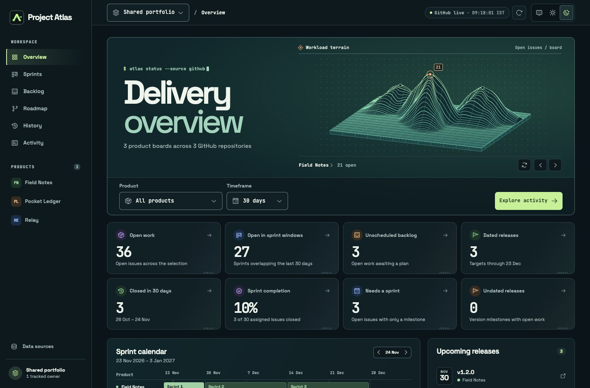

# Project Atlas

Project Atlas gives product owners and maintainers one place to see what each team has scheduled, which issues still need a plan, what has closed, and which releases have a target date. It reads public GitHub Projects and links each result back to its source. Anyone can use the shared dashboard or build a personal portfolio of public GitHub accounts in their browser, without signing in.

**[Open Project Atlas](https://pipeline.theharithsanotes.com/)** · [Current sprints](https://pipeline.theharithsanotes.com/#sprints) · [Backlog](https://pipeline.theharithsanotes.com/#backlog) · [Issue history](https://pipeline.theharithsanotes.com/#history) · [Release roadmap](https://pipeline.theharithsanotes.com/#roadmap) · [Activity](https://pipeline.theharithsanotes.com/#activity)

<picture>
  <source media="(prefers-color-scheme: light)" srcset="docs/images/overview-light.jpg">
  
</picture>

*The screenshots use fictional products and issues. The live dashboard reads the configured GitHub boards.*

## Read the dashboard

| To answer this question | Open |
| --- | --- |
| Which boards have the most open work? | On **Overview**, the tallest terrain peak has the most open issues. Select a marker or use the arrows to inspect a board, then open its name. |
| Where do I change appearance? | Use the monitor, sun and moon in the top bar for **System**, **Light** and **Dark**. Light uses a pure white workspace. Atlas remembers your choice in this browser. |
| What is in flight for one product? | Choose the product in **Overview**, then open a sprint in the calendar to see its issues. |
| Which issues still need planning? | **Backlog → Unscheduled** shows open work without a sprint or delivery milestone. **Board backlog** shows the source board’s Backlog and Todo statuses, including scheduled issues. |
| Which issues closed recently? | **History** lists closed issues newest first. Select a product or search by issue number, title or repository. |
| How do I build my own dashboard? | Choose **My portfolio** at the top, enter GitHub users and organizations, then select **Save and view my portfolio**. Switch back to **Shared portfolio** at any time. |
| How do I share the sprint I’m looking at? | In **My portfolio**, open a product and sprint, apply your filters, then choose **Share view → Copy link**. Anyone who opens it sees that live selection. Both dashboards keep their saved settings. |
| Where can I see coding activity? | Open **Activity** and choose **Projects** for the selected repositories or **Developer** for a GitHub username. Select a time range from four weeks through five years. Select a month or use the calendar arrows to see daily counts. Compare **Contributions in range** with **Lifetime contributions** since the developer joined GitHub. |
| How do I change the shared accounts? | **Data sources → Edit owners on GitHub** opens the shared user and organization list for a pull request. |
| What is expected to ship next? | **Roadmap** shows versioned milestone targets. **Data sources** links to the latest published release for each repository. |
| Which work closed or still needs scheduling? | Use **Timeframe** at the top of Overview to select 7–365 days. The closure, sprint and upcoming release tiles open the same period in their detail views. |
| How fresh are the numbers? | The status at the top shows the last board check in India time. Open **Data sources** for coverage or use the refresh button. |

While the page is visible it checks boards every minute. Repository milestones and release tags refresh on demand every three minutes. Recent commit activity refreshes hourly on demand. Longer windows load historical years when selected. Completed past years refresh daily. Workload counts exclude pull requests, archived entries and parent rollups. Atlas discovers open public boards under the configured users and organizations every ten minutes. It checks for changes to the shared owner settings every five minutes while the dashboard is in use. The dashboard also tracks its own work. [Atlas sprint](https://pipeline.theharithsanotes.com/#sprints?product=theharithsa-5) · [Atlas planning board](https://github.com/users/theharithsa/projects/5) · [Dashboard guide](docs/handbook.md)

## Run locally

Use Node.js 22 and a network connection to GitHub. The local server uses the same public collector as the deployed site.

```sh
git clone https://github.com/theharithsa/project-atlas.git
cd project-atlas
npm ci --ignore-scripts
npm start
```

Open [localhost:4179](http://127.0.0.1:4179/). The preview reads the owner list from your local checkout. You can try different logins before proposing a shared change. [Owner settings](config/owners.json) To choose a different port, run `npm start -- 4180`. To install the Firebase function dependencies and run the application tests:

```sh
npm ci --prefix functions --ignore-scripts
npm test
```

## How it works

The frontend uses Astryx’s Neutral theme in light and dark, CSS tokens and build-time Button and Badge components. It ships static HTML, CSS and JavaScript with self-hosted Phosphor icons and the Space Grotesk and JetBrains Mono fonts. Firebase Hosting routes `GET /api/v1/portfolio` to a Node.js function. The function lists public projects by owner, reads each open board as a signed-out visitor and discovers repositories from verified public issues and pull requests. An empty board can appear as soon as GitHub lists it. Add a public issue or PR from each repository to include its milestones and latest release. Personal mode reads individual public owners through the same collector and combines their boards and releases in the browser. The shared feed and each personal owner have independent caches. The browser never needs a GitHub token.

| Source | Responsibility |
| --- | --- |
| [config/owners.json](config/owners.json) | Shared GitHub users and organizations, applied after merge without a Firebase deployment |
| [site/](site/) | Themed workspace, interactive workload terrain, contribution calendar, planning and release views |
| [scripts/build.mjs](scripts/build.mjs) | Build the pinned Astryx CSS, control markup, icon sprite and fonts for Hosting |
| [functions/](functions/) | GitHub collection, visibility filtering, caching and the public HTTPS handler |
| [firebase.json](firebase.json) | Dedicated Hosting site, function rewrite and cache headers |
| [docs/api.md](docs/api.md) | API contract, data scope, timestamps and failure behavior |
| [docs/delivery.md](docs/delivery.md) | Pull request checks, release, Firebase deployment and rollback |

To report a mismatch, include the public board or milestone link, the active dashboard filter and the displayed check time. [Open an issue](https://github.com/theharithsa/project-atlas/issues/new/choose) · [Contributing](CONTRIBUTING.md) · [Security reporting](SECURITY.md) · [Release history](CHANGELOG.md)

## License

Project Atlas and the inherited App Launchpad foundation are MIT licensed. Astryx and Phosphor Icons are MIT licensed. Space Grotesk and JetBrains Mono are distributed under the SIL Open Font License 1.1. [MIT license](LICENSE) · [Bundled notices](https://pipeline.theharithsanotes.com/generated/licenses.txt) · [Template provenance](docs/versioning.md)
