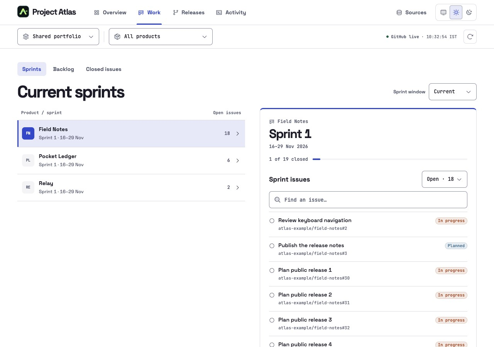

# Dashboard guide

Start with the whole portfolio or choose a product in the sidebar. A product selection follows you to Sprints, Backlog, History and Roadmap. A link in the browser’s address bar preserves the selected view and filters. [Open the live dashboard](https://pipeline.theharithsanotes.com/)

## Use a personal portfolio

**Shared portfolio** is the default on a new browser. Open the portfolio selector in the top bar and choose **My portfolio**. An empty personal list opens **Data sources**. [Open settings](https://pipeline.theharithsanotes.com/#sources)

1. In **My portfolio owners**, enter GitHub account logins under **GitHub users** or **GitHub organizations**. Separate multiple logins with commas. For example, try `octocat` under users and `vitejs` under organizations. You can track up to 12 accounts across both lists.
2. Choose **Save and view my portfolio**. Open Overview, Sprints, Backlog, Roadmap or History to use your selection. Public projects are discovered for each account, including owners outside the shared settings. An account with no open public boards contributes zero products.
3. Change the selector to **Shared portfolio** to see the maintained dashboard again. Your personal list is available when you switch back or reload. To update it, open **Data sources**. To remove every entry, use **Clear list**.

Your browser stores the list and selected mode on this site. Each feed request carries one public GitHub login and its account type. A different browser starts with its own settings. If browser storage is unavailable, selections last for the current tab session. An ordinary page URL opens with the recipient’s saved portfolio. Use **Share view** to include your owner selection.

If an owner fails, check the login and its type in **Data sources**. The dashboard can show other available owners and identifies missing coverage. You can edit your list or switch back to shared even during a complete outage.

## Share the current view

In **My portfolio**, open the product, sprint and issue filter you want someone to see. Choose **Share view → Copy link**. You can also select and copy the address directly. The link includes the selected users and organizations, current page, product and filters, including an issue search and its page. Anyone with the link can read these selections. GitHub data stays live, so counts and issue ordering can change.

Recipients see **Linked portfolio**. They can follow links within the portfolio, reload it, or select **Return to my dashboard** to restore their own selection. If a project or sprint has disappeared, Atlas identifies it as unavailable. [Example linked sprint](https://pipeline.theharithsanotes.com/#p/1/theharithsa/-/sprints?product=theharithsa-5&sprint=eb6c9abc&show=closed)

## Read the overview metrics

| Tile | What it measures and where it opens |
| --- | --- |
| Closed in 7 days | Unique closed board issues with a GitHub closure timestamp on today’s India calendar date or the six preceding dates. Opens the same period in History. |
| Sprint completion | Closed leaf issue assignments divided by all leaf issue assignments across active sprints, weighted by issue count. Opens current sprints. |
| Needs a sprint | Open leaf issues with a delivery or planning milestone and no assigned sprint. Opens the Milestone only backlog. |
| Undated releases | Open version milestones with outstanding work and no due date, counted once per repository milestone. Opens the matching roadmap filter. |

## Explore coding streaks

Open **Overview → Coding streak**. **Projects** counts default-branch commits in the selected boards’ public repositories. A repository on two boards counts once. **Developer** accepts a GitHub username and uses GitHub’s public commit search across repositories. GitHub must associate the commit author with the chosen account. The product filter continues to apply to the delivery tiles while the developer search follows the username across GitHub. [How GitHub searches commits](https://docs.github.com/en/search-github/searching-on-github/searching-commits)

The calendar shows 28 dates in India time, using the commit’s committed timestamp and including merges. Select a square to read the date and count. The current streak can end yesterday while today is still open. The best streak and active days cover only the displayed period. A hatched day has unknown activity, and **≥** indicates a confirmed minimum. GitHub indexing, rate limits and pagination can affect coverage. Complete activity refreshes hourly on demand. [Developer example](https://pipeline.theharithsanotes.com/#overview?activity=developer&developer=theharithsa)

## Change the shared portfolio owners

1. Select **Shared portfolio**, then open **Data sources → Shared portfolio owners → Edit owners on GitHub**. Sign in to GitHub to propose a change. The two lists contain account logins, as shown in GitHub profile URLs. [Live settings](https://pipeline.theharithsanotes.com/#sources) · [Shared file](../config/owners.json)
2. Add or remove logins in `users` and `organizations`. Keep both arrays. Either may be empty, and two empty arrays produce an empty dashboard. Repeated logins of the same type count once. Assign each login to exactly one type.
3. Open a pull request. A repository maintainer can merge it after the checks pass. The merged list applies to everyone. While the dashboard is in use the feed checks for changes every five minutes. GitHub and dashboard caching can add a short delay. Settings-only edits take effect without a Firebase deployment. [GitHub file editing](https://docs.github.com/en/repositories/working-with-files/managing-files/editing-files)

For example, this file would track one personal account and one organization. Replace each example login with your own.

```json
{
  "users": ["octocat"],
  "organizations": ["github"]
}
```

## Add a product

1. Create a GitHub Project under a configured user or organization, set its visibility to public and leave it open. Atlas checks those owners’ directories every ten minutes while the dashboard is in use. The visible tab polls the feed every minute.
2. Add a public issue or pull request from each repository the board tracks. That gives Atlas a verified link to the repository’s milestones and latest published release. An empty board appears with zero items. A repository by itself does not create a product.
3. Use a native iteration field for sprints. Assign planned work to a sprint and leave unscheduled issues in Todo or Backlog. Set dates on GitHub release milestones when the team has agreed on a target.

Select the product in Atlas to follow its work. Project Atlas uses the same discovery path as every other board. [Atlas sprints](https://pipeline.theharithsanotes.com/#sprints?product=theharithsa-5) · [Atlas backlog](https://pipeline.theharithsanotes.com/#backlog?product=theharithsa-5) · [Atlas roadmap](https://pipeline.theharithsanotes.com/#roadmap?product=theharithsa-5)

## Follow a sprint

Select a colored sprint window in the calendar. The detail page shows its dates, issue closure and individual issues. The list opens with all issues. Choose **Open** or **Closed** to narrow it. Search by title, number or repository, then open an issue to see the source discussion. Sprint membership uses the native GitHub iteration ID. The first and last days both count, using the board check date in Asia/Kolkata.



## Interpret the backlog

**Unscheduled** includes open leaf issues with a Backlog, Todo or missing status, no sprint and no delivery milestone. Intake milestones such as Backlog triage can still appear here. **Milestone only** is useful for scoped work that still needs a sprint. **Board backlog** mirrors the board’s own Backlog and Todo statuses. An item can therefore appear in its assigned sprint and in Board backlog.

## Find closed work

Open **History** for the whole portfolio or select a product to narrow it. Search by title, issue number, repository or closure reason. Each row links to the issue and its product or sprint. An issue on several selected boards appears once with links to each membership. [Portfolio history](https://pipeline.theharithsanotes.com/#history) · [Atlas history](https://pipeline.theharithsanotes.com/#history?product=theharithsa-5)

History includes closed parent issues and issues that never had a sprint. The newest closures appear first using GitHub’s closure timestamp, displayed in India time. If GitHub supplies a reason, such as **Not planned**, the row shows it. Rows with no closure date appear last. When GitHub reopens an issue, it leaves the closed list on refresh. **Repository history** links to GitHub’s full closed-issue list for each represented repository, including issues archived on or removed from the board.

## Follow a release

The roadmap reads open GitHub milestones. A date is the target set on the milestone. Open **Data sources → Repository releases** to verify which version the repository actually published. A sprint closure percentage measures closed issues, including early closures.

## Investigate a discrepancy

Use the board check time in the top bar and check the selection under **Data sources**. A partial feed lists unavailable sources and totals cover the sources that responded. During a temporary full outage an open page retains its previous timestamped view for up to ten minutes. The page retries when it regains visibility or network connectivity. [Source links and counting rules](https://pipeline.theharithsanotes.com/#sources)
